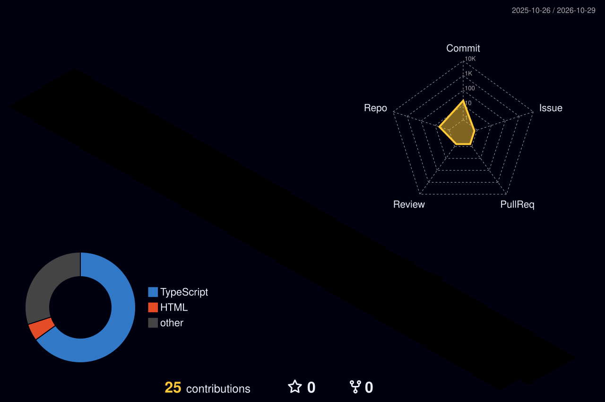

<!-- =========================================================
     CHIRAG MALI | GITHUB PROFILE README
     Repository: ckfuturetech19/ckfuturetech19
     ========================================================= -->

<div align="center">

<!-- Animated typing headline -->
<a href="https://git.io/typing-svg">
  
</a>

<br/>

### 📱 Solo Developer · Flutter Engineer · Full-Stack Product Builder

*I build complete digital products — from mobile apps and backend APIs to web applications, admin dashboards, and real-time experiences.*

<br/>

<a href="https://chiragmali.netlify.app">
  
</a>
<a href="https://play.google.com/store/apps/dev?id=6356354072109465902">
  
</a>
<a href="https://www.linkedin.com/in/chirag-mali-491b72278/">
  
</a>
<a href="mailto:malichirag1369@gmail.com">
  
</a>

<br/><br/>


</div>

---

## 👨‍💻 About Me

Hey! I'm **Chirag Mali**, a developer from Ahmedabad, Gujarat, India. I enjoy designing, developing, and shipping products that solve real-world problems.

I'm especially interested in building products end to end instead of stopping at the UI.

- 🚀 **Solo product development:** Building and maintaining my own apps.
- 📱 **Mobile development:** Flutter and Dart, with native Android integrations when needed.
- ⚙️ **Backend engineering:** REST APIs, authentication, databases, and application architecture.
- 🖥️ **Web development:** React, Next.js, TypeScript, and admin dashboards.
- 🔐 **Security:** Exploring end-to-end encryption and secure application design.
- 🤖 **AI integration:** Adding practical AI features to real products.
- 🧩 **Beyond the app:** Widgets, real-time synchronization, notifications, subscriptions, and deployment.

```text
Idea → UI/UX → Mobile App → Backend → Web Dashboard
                    ↓
        Testing → Deployment → Improvements
```

> My goal: build useful products with thoughtful UX, maintainable architecture, and reliable production systems.

---

## 🚀 Products & Projects

<div align="center">

<a href="https://play.google.com/store/apps/details?id=com.ckfuturetech.onlyus">
  
</a>
<a href="https://play.google.com/store/apps/details?id=com.ckfuturetech.taskmate">
  
</a>
<a href="https://play.google.com/store/apps/details?id=com.ckfuturetech.splitbuddy">
  
</a>

</div>

### ❤️ 01. OnlyUs — Couples Chat & Shared Life

<div align="center">

<a href="https://play.google.com/store/apps/details?id=com.ckfuturetech.onlyus">
  
</a>

**More than a chat app — a shared digital space for two.**

</div>

A couples-focused application combining private communication, shared activities, and relationship-focused experiences.

**💬 Communication**
- Real-time chat with replies, reactions, and media sharing.
- Voice notes, typing indicators, and online/last-seen status.
- Calling features for connecting with your partner.

**🔐 Privacy & Security**
- End-to-end encryption architecture.
- X25519 key exchange and AES-GCM encryption.
- Secure private-key storage and encrypted backup/recovery flows.

**🎨 Interactive Experiences**
- Live doodle drawing and creative interactions.
- Relationship garden, growth, streaks, and levels.
- Shared moods, memories, notes, tasks, and calendar.
- Live location sharing and an AI-powered assistant.

**🧩 Widgets & Personalization**
- Home-screen widget experiences.
- Quick access to shared information and couple-focused features.
- Chat themes and Material Design 3 UI.

**Tech Stack**

`Flutter` `Dart` `Riverpod` `Firebase` `Firestore` `X25519` `AES-GCM` `flutter_secure_storage`

<div align="center">

<a href="https://play.google.com/store/apps/details?id=com.ckfuturetech.onlyus">
  
</a>

</div>

---

### ✅ 02. TaskMate — Smart ToDo & Productivity

<div align="center">

<a href="https://play.google.com/store/apps/details?id=com.ckfuturetech.taskmate">
  
</a>

**One productivity ecosystem. Mobile, backend, web, and administration.**

</div>

TaskMate is a smart productivity application designed to help users capture tasks, organize their schedules, and stay focused.

**📱 Mobile Application**
- Task management, subtasks, and recurring tasks.
- Voice-to-task workflows.
- Reminders and notification support.
- Calendar synchronization.
- Focus timer and productivity tools.
- Multiple themes and six-language support.

**🧠 AI & Smart Productivity**
- AI-powered task enhancement.
- AI document analysis.
- Smarter task capture and organization.

**🧩 Widgets & Daily Planning**
- Home-screen widgets for quick task access.
- At-a-glance task information.
- Productivity workflows designed to reduce friction.

**⚙️ Complete Product Infrastructure**
- Custom backend services for application workflows.
- Dedicated web application.
- Web-based admin panel.
- Subscription and premium feature management.
- API integrations and production maintenance.

**Tech Stack**

`Flutter` `Dart` `GetX` `Firebase` `REST APIs` `Custom Backend` `Web Applications` `AI Integrations`

<div align="center">

<a href="https://play.google.com/store/apps/details?id=com.ckfuturetech.taskmate">
  
</a>

</div>

---

### 💸 03. SplitBuddy — Shared Expense Management

**Make group spending easier to organize and understand.**

A personal product focused on helping people manage shared expenses and keep track of group spending.

- 👥 Group expense tracking.
- 💰 Expense splitting and balance tracking.
- 🌍 Multi-currency support.
- 📊 Clearer visibility into shared financial responsibilities.
- 📱 Mobile-first experience.

**Tech Stack**

`Flutter` `Dart` `State Management` `Data Modeling`

<div align="center">

<a href="https://play.google.com/store/apps/details?id=com.ckfuturetech.splitbuddy">
  
</a>

</div>

---

### 🏫 04. School ERP — Multi-Tenant Management Platform

**A structured school management platform built across mobile, backend, and web.**

- 🏢 Multi-tenant architecture with school-scoped data.
- 🔐 Authentication, authorization, and dynamic role-based permissions.
- 📱 Flutter mobile application with tablet support.
- 🖥️ React and TypeScript administration interface.
- ⚙️ Centralized REST API hosted on Google Cloud Run.
- 🔥 Firebase Authentication and Firebase Admin SDK integration.
- 🧪 Automated testing across Flutter and backend components.

**Architecture**

```text
Flutter Mobile App       React Admin Panel
         \                    /
          \                  /
           Central REST API
                  |
        Authentication & Roles
                  |
       Tenant-Aware Data Access
                  |
            Cloud Services
```

The October 2026 project audit recorded **231/231 Flutter tests** and **86/86 backend tests** passing at that time.

**Tech Stack**

`Flutter` `Dart` `React` `TypeScript` `Node.js` `Cloud Run` `Firebase Admin SDK` `REST API`

---

### 🤖 05. AI & Experimental Projects

I also explore AI integrations and smaller products that let me experiment with new ideas, interfaces, and technical approaches.

- 🌿 **LeafLens AI** — plant-focused AI application experience.
- 🎡 **Spin the Wheel** — interactive wheel-based application.
- 🎮 **Tappy Tac Toe** — game development and interactive UI.
- ✈️ **TravelNest** — travel-focused application concept.
- 🍳 **CookSmart** — recipe and food discovery concept.
- 🧠 **AI Mood Detector** — academic project exploring AI-based mood detection.

*Project descriptions reflect their general purpose; implementation and release status may differ.*

---

## 🧰 Tech Stack & Tools

<div align="center">

### Mobile Development


### Frontend & Web


### Backend & Databases


### Cloud, Dev Tools & Design


</div>

### More of my toolkit

| Area | Technologies |
|---|---|
| Languages | Dart, Java, JavaScript, TypeScript, Python basics |
| Flutter state management | Riverpod, BLoC/Cubit, GetX, Provider |
| Architecture | Clean Architecture, MVVM, SOLID principles |
| Backend | Node.js, REST APIs, Laravel |
| Databases | PostgreSQL, Firestore, SQLite |
| Firebase | Authentication, Firestore, Cloud Messaging, Storage |
| AI & ML | Gemini API, OpenAI API, Google ML Kit, TensorFlow Lite |
| Mobile capabilities | Notifications, widgets, calendar integration, native Android integrations |
| Payments | Google Play Billing, RevenueCat |
| Cloud & deployment | AWS, Google Cloud Run, Firebase, Netlify |
| Development tools | Git, GitHub, Postman, Flutter DevTools |

---

## 📊 GitHub Overview

<div align="center">

<!-- Dynamic GitHub stats -->


<br/><br/>


</div>


## 🟩 My GitHub Contributions

<p align="center">
  
</p>

</div>


---

## 💼 Professional Experience

**Software Developer — BOSC Tech Labs Pvt. Ltd.**  
*January 2025 – February 2026 · Ahmedabad, India*

- Developed and maintained Flutter applications.
- Worked with Clean Architecture and MVVM patterns.
- Integrated APIs and handled application errors and edge cases.
- Contributed to projects including Spin the Wheel, LeafLens, and FoundersMate.

**Android App Development Intern — Corizo**  
*December 2023 – February 2024 · Remote*

- Gained practical experience in Android application development.
- Worked on mobile development fundamentals and implementation.

---

## 🎓 Education

**B.Tech in Information Technology**  
Indus University, Ahmedabad, Gujarat  
2021 – 2025

---

## 🌱 What I'm Focused On

- Building reliable and polished Flutter applications.
- Improving backend architecture and API design.
- Creating useful native Android integrations and home-screen widgets.
- Developing secure real-time applications.
- Exploring scalable product architecture and cloud infrastructure.
- Improving testing, performance, and release workflows.

---

## 🤝 Let's Connect

<div align="center">

Have an interesting product idea, a technical challenge, or an opportunity to collaborate? Let's talk!

<br/>

<a href="https://chiragmali.netlify.app">
  
</a>
<a href="https://www.linkedin.com/in/chirag-mali-491b72278/">
  
</a>
<a href="mailto:malichirag1369@gmail.com">
  
</a>
<a href="https://play.google.com/store/apps/dev?id=6356354072109465902">
  
</a>

<br/><br/>

**Built with curiosity, shipped with persistence.** 🚀


</div>
